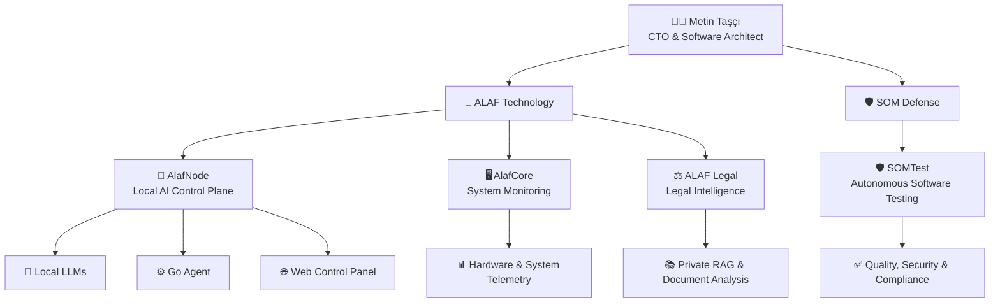
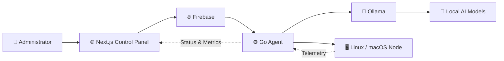
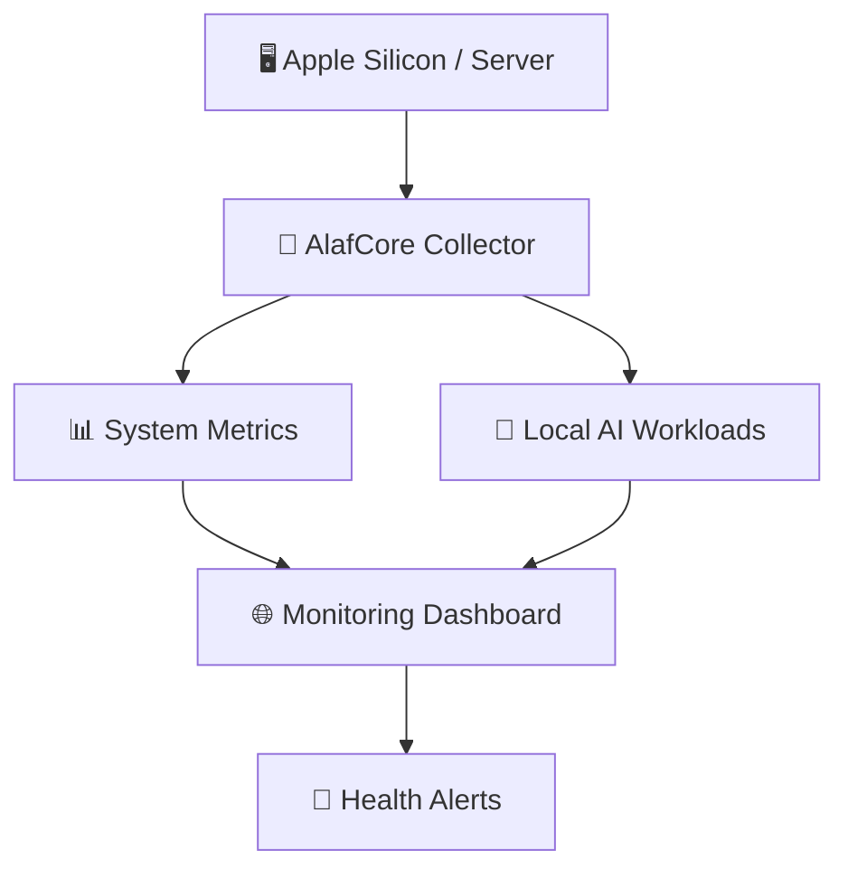
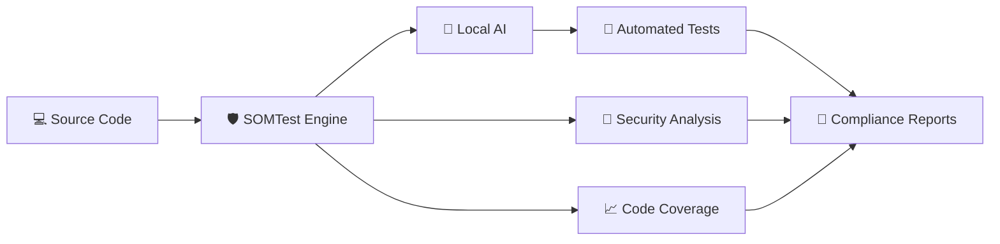
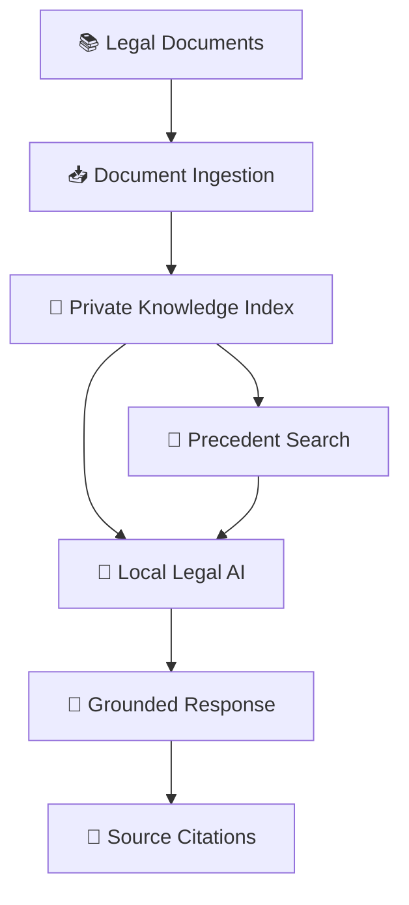
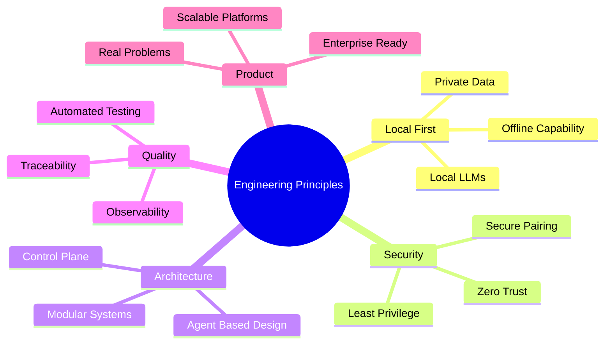
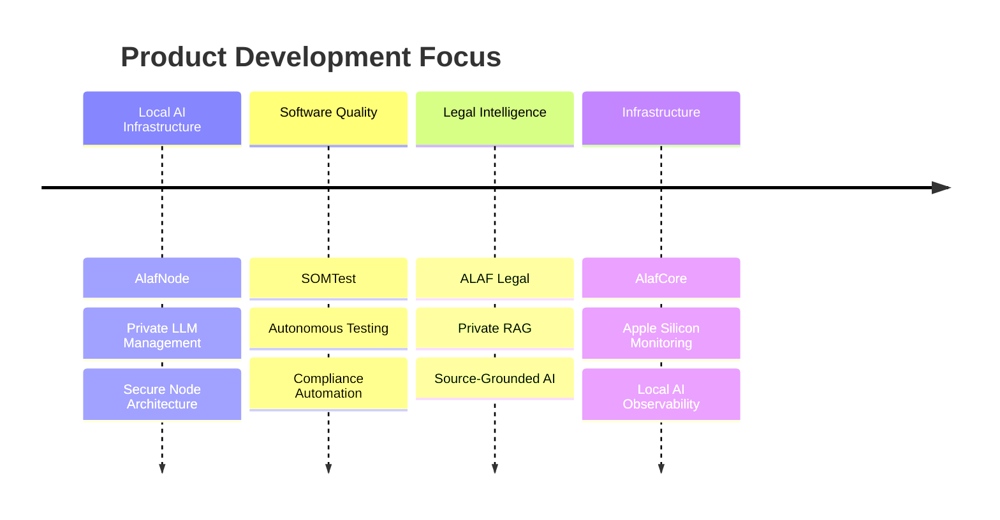

# 👋 Hi, I'm Metin Taşçı

### CTO • Software Architect • Product Builder

I design and build secure, local-first and AI-powered software platforms.

My work focuses on:

**Local AI Infrastructure • Autonomous Testing • Legal AI • System Monitoring • Secure Software Architecture**

---

## 🏗️ Product Ecosystem

---

# 🧠 **AlafNode**

> **A production-oriented local AI infrastructure platform for deploying, pairing and managing private AI nodes.**

AlafNode provides a centralized control plane for running and managing local artificial intelligence infrastructure without sending sensitive data outside the organization.

### Key Capabilities

- Secure node registration and pairing
- Local LLM deployment and management
- Ollama integration
- Remote node monitoring
- Agent-based system control
- Private and local-first AI architecture
- Centralized web management panel
- Secure communication between nodes
- Multi-node infrastructure support

### Architecture

> **Core technologies:** Next.js, TypeScript, Go, Firebase, Ollama, Linux, Local LLMs

---

# 🖥️ **AlafCore**

> **A lightweight infrastructure and hardware monitoring ecosystem designed specifically for Apple Silicon and local AI systems.**

AlafCore provides visibility into system health, hardware resources and local AI workloads.

### Key Capabilities

- CPU, RAM and storage monitoring
- Apple Silicon system telemetry
- Local AI workload observation
- Hardware health monitoring
- Resource utilization tracking
- Node-level observability
- Infrastructure status reporting
- Lightweight monitoring architecture

> **Core technologies:** Go, Swift, TypeScript, macOS, Linux, Apple Silicon, System Telemetry

---

# 🛡️ **SOMTest**

> **A local-first software quality and security platform designed for high-assurance and regulated environments.**

SOMTest automates software testing, security analysis and compliance reporting while keeping source code inside the organization.

### Key Capabilities

- Autonomous test generation
- Static code analysis
- Security testing
- Code coverage analysis
- Traceability reporting
- Local AI-assisted testing
- Zero-trust architecture
- Private source code processing
- Compliance-oriented reporting

### Target Standards

- DO-178C
- MIL-STD-498
- DISA STIG
- Secure software development practices
- High-assurance quality processes

> **Core technologies:** Local LLMs, Static Analysis, Automated Testing, Security Testing, Compliance Reporting

---

# ⚖️ **ALAF Legal**

> **An AI-assisted legal intelligence platform built around private deployment, source-grounded responses and auditable outputs.**

ALAF Legal is designed to analyze legal documents, retrieve relevant decisions and produce traceable AI-assisted outputs.

### Key Capabilities

- Legal document analysis
- Private RAG infrastructure
- Source-grounded AI responses
- Similar case and precedent retrieval
- Large document summarization
- Petition and defense draft assistance
- Auditable outputs
- Institution-level data isolation
- Local and private deployment

> **Core technologies:** RAG, Local LLMs, Vector Search, Document Analysis, Legal AI, Private Infrastructure

---

# 🚀 **Additional Product Work**

### SOM Crypto

A non-custodial cryptocurrency wallet focused on Ethereum and USDT transactions.

- React Native
- Biometric and PIN protection
- QR-based transactions
- Testnet and mainnet support
- Secure local wallet architecture

### AI-Powered Defense Systems

Research and product development involving:

- Computer vision
- Autonomous systems
- Drone technologies
- Facial recognition
- Secure edge AI
- Local inference infrastructure

### Enterprise AI Platforms

Development of private AI systems for:

- Document analysis
- Internal knowledge retrieval
- Software quality assurance
- Infrastructure management
- Regulated and high-security environments

---

## 🧩 Engineering Approach

---

## 🛠️ Technology Stack

### Languages

### Frontend

### Backend & Infrastructure

### Artificial Intelligence

---

## 📍 Current Focus

---

## 🤝 Leadership

As a CTO and product architect, I focus on turning complex technical requirements into reliable and commercially viable software platforms.

My responsibilities include:

- Product and technology strategy
- Software architecture
- AI infrastructure design
- Engineering team leadership
- Security and privacy architecture
- Technical research and development
- Enterprise and defense technology projects
- Product delivery from concept to production

---

## 📊 GitHub Statistics

---

## 📫 Contact

**Alaf Teknoloji Savunma Sanayi ve Havacılık A.Ş.**

🌐 [alafteknoloji.com](https://alafteknoloji.com)

💻 [github.com/mtntasci](https://github.com/mtntasci)

---

### Building secure, private and intelligent systems.

