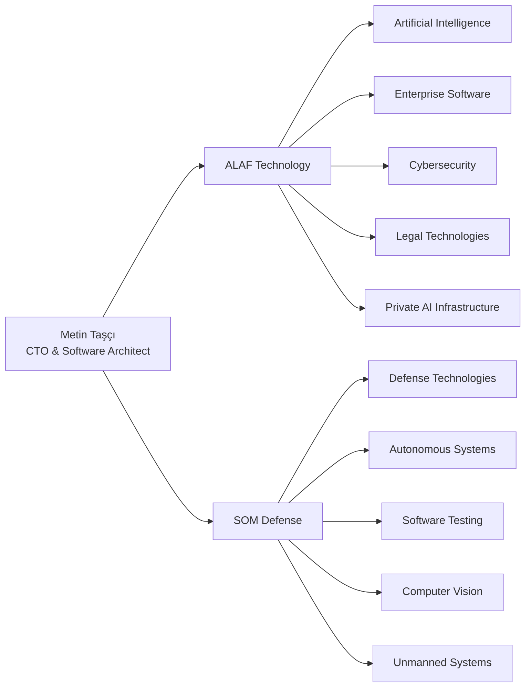
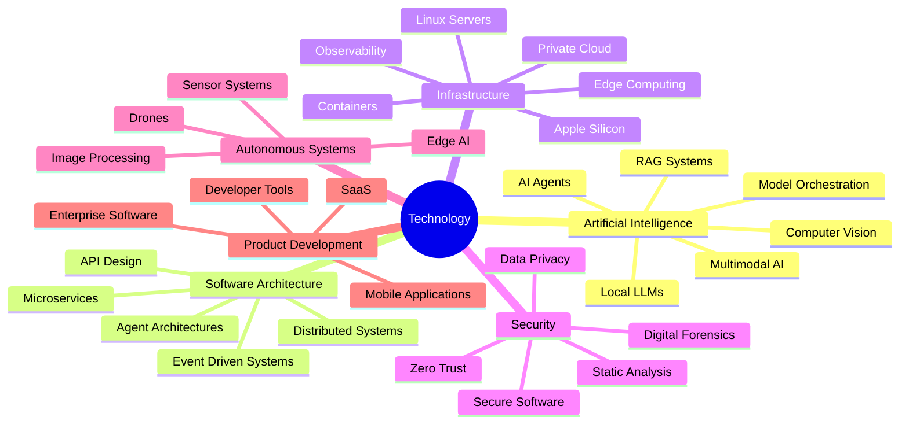
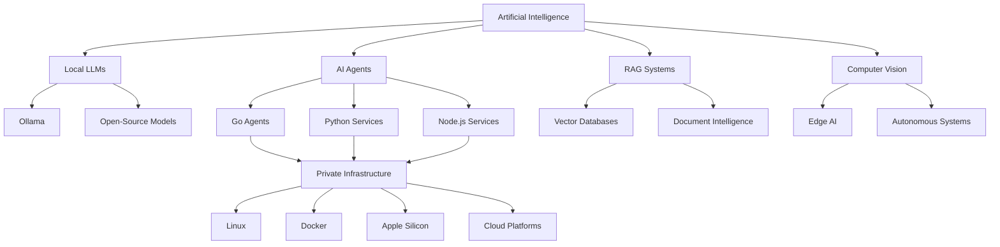
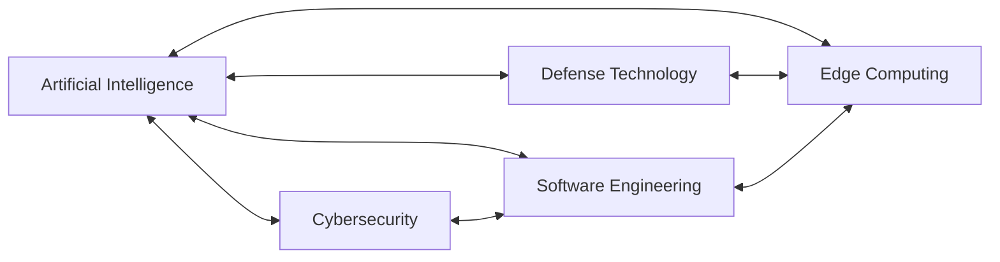

# Metin Taşçı

### CTO • Technology Entrepreneur • Software Architect

Building secure, private and intelligent systems across
**Artificial Intelligence, Defense Technologies, Software Quality and Autonomous Systems**

---

## About Me

I am a technology entrepreneur and software architect focused on developing secure, scalable and commercially viable technology platforms.

As the founder and technology executive of companies operating in software and defense technologies, I work across product strategy, system architecture, artificial intelligence infrastructure, engineering management and research and development.

My primary focus is turning complex technical requirements into reliable systems that can operate securely in private, regulated and high-assurance environments.

---

## Companies & Fields of Activity

### **ALAF Technology**

ALAF Technology operates in the fields of:

* Artificial intelligence platforms
* Private and local AI infrastructure
* Enterprise software development
* Legal technologies
* Cybersecurity solutions
* Data analysis and document intelligence
* Infrastructure monitoring
* Web and mobile application development
* Research and development

### **SOM Defense**

SOM Defense focuses on:

* Defense software technologies
* Autonomous systems
* Unmanned aerial systems
* Computer vision
* Artificial intelligence at the edge
* Secure communication architectures
* Mission-critical software
* Software quality and security testing
* High-assurance and regulated systems

---

## Technology Interests

---

## Current Areas of Focus

* Local and private artificial intelligence systems
* Local LLM deployment and orchestration
* AI agents and autonomous workflows
* Retrieval-Augmented Generation systems
* Secure enterprise AI infrastructure
* Apple Silicon and GPU-based local computing
* Software quality automation
* Static code and security analysis
* Autonomous testing systems
* Computer vision and image processing
* Defense and mission-critical software
* Legal document intelligence
* Infrastructure monitoring and observability
* Edge computing
* Distributed agent architectures
* Non-custodial blockchain applications

---

## Technical Ecosystem

---

## Languages & Frameworks

### Programming Languages

### Web & Mobile

### Artificial Intelligence

### Infrastructure & Data

---

## Engineering Principles

I believe that modern software systems should be:

* **Secure by default**
* **Private by design**
* **Local-first where possible**
* **Observable and auditable**
* **Modular and maintainable**
* **Independent from unnecessary vendor lock-in**
* **Designed around real operational requirements**
* **Built as products rather than temporary prototypes**

---

## Architecture & Leadership

My work includes:

* Technology and product strategy
* Software and system architecture
* Artificial intelligence infrastructure design
* Engineering team leadership
* Research and development management
* Technical feasibility analysis
* Security and privacy architecture
* Productization of research projects
* Enterprise and defense technology development
* Architecture review and technical decision-making
* Local computing and homelab infrastructure
* Moving systems from proof of concept to production

---

## Research & Development

I am particularly interested in the intersection of:

* Artificial intelligence and secure software
* Local AI and data sovereignty
* Autonomous systems and edge computing
* AI-supported software testing
* Computer vision and unmanned systems
* Private RAG and document intelligence
* Agent-based infrastructure management
* Apple Silicon for local AI workloads
* Open-source AI deployment
* High-assurance software development

---

## GitHub Statistics

 

---

## Contact

**ALAF Technology Defense Industry and Aviation Inc.**

[alafteknoloji.com](https://alafteknoloji.com)

[github.com/mtntasci](https://github.com/mtntasci)

 

### Secure systems. Private intelligence. Real-world technology.

